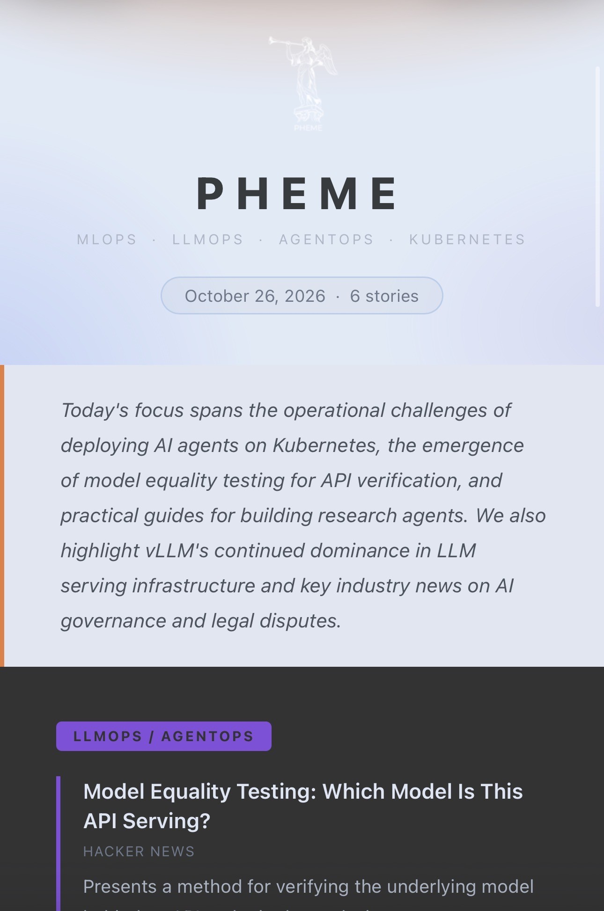
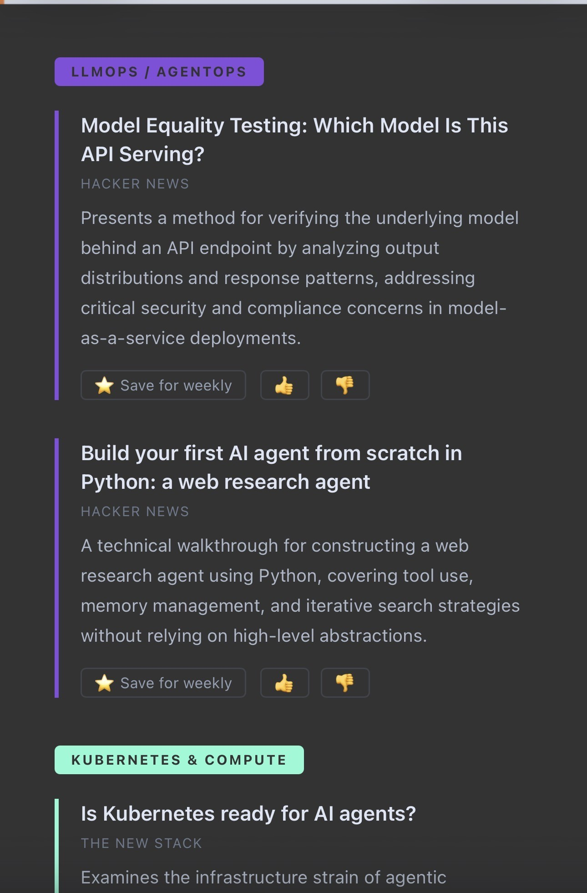
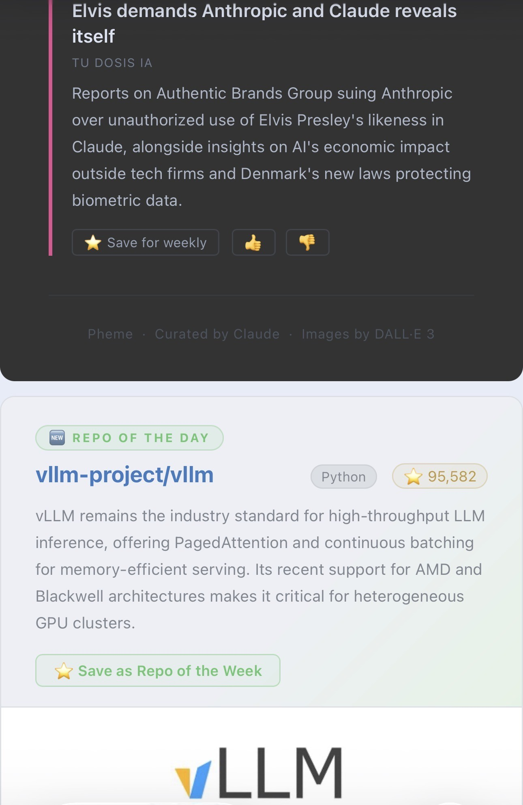
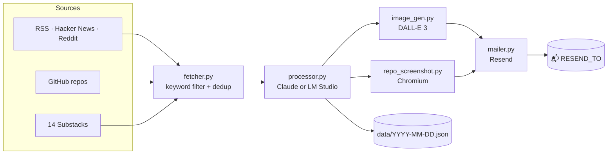

<div align="center">


# Pheme

**Your daily MLOps briefing, curated by an LLM and delivered to your inbox.**


*In Greek mythology, Pheme was the goddess of fame, rumor, and news — a hundred eyes, a hundred ears, a hundred mouths.*

</div>

---

## ✨ What you get

Every morning, one email with:

| | |
|--|--|
| 📰 **4 stories** | MLOps, LLMOps / AgentOps, Kubernetes & compute, research — picked from RSS, Hacker News, Reddit |
| 🗞️ **News** | 1–3 of the best posts from 14 Substack newsletters (English + Spanish, always summarized in English) |
| ⭐ **Repo of the Day** | A trending GitHub repo with a screenshot of its README |
| 🎨 **Header image** | Generated by DALL-E 3 (optional) |

<p align="center">
  
  
  
</p>
<p align="center"><sub>A real issue from Oct 26, 2026</sub></p>

Plus a **weekly digest** of the stories you starred, and ⭐ / 👍 / 👎 links that record your feedback.

Runs on **Claude** in the cloud, or **fully local** on a Mac with LM Studio — zero API cost.

---

## 🚀 Quickstart

```bash
git clone https://github.com/pabloesc/pheme ~/pheme && cd ~/pheme
uv venv --python 3.12 .venv && uv pip install --python .venv/bin/python -r requirements.txt
.venv/bin/playwright install chromium          # for the README screenshot
cp .env.example .env                           # add your keys and RESEND_TO
.venv/bin/python main.py --dry-run --test      # preview — no email sent
```

No `uv`? `python3.12 -m venv .venv && .venv/bin/pip install -r requirements.txt` works too.

| Command | What it does |
|--|--|
| `python main.py --dry-run` | Fetch + curate, print the newsletter JSON. No image, no screenshot, no email |
| `python main.py --dry-run --test` | Same, trimmed to 3 articles, 2 repos, 3 Substack posts — fast |
| `python main.py --test` | Small run that **sends** the email |
| `python main.py` | Full run: curate, image, screenshot, send to `RESEND_TO` |
| `python weekly.py [--dry-run]` | Weekly digest |
| `python server.py` | Feedback server on `:8765` (needed for ⭐ / 👍 / 👎 links) |

---

## 🧭 How it works



1. **Fetch** — the last 24 hours of news, recently active GitHub repos, and the last 7 days of Substack posts.
2. **Filter** — keyword matching keeps the top 12 candidates. Repos and Substack posts featured in the last 30 days are skipped.
3. **Curate** — one LLM call picks the stories, News and Repo of the Day, writes the summaries and an image prompt.
4. **Render & send** — header image, README screenshot, HTML email via Resend.
5. **Archive** — the newsletter is saved to `data/YYYY-MM-DD.json` for the weekly digest.

<details>
<summary><b>Sources</b></summary>

- **RSS**: MLOps Community, The New Stack, Kubernetes Blog, CNCF, DeepLearning.AI, Hugging Face
- **Hacker News** (Algolia API): 6 topic queries
- **Reddit**: `r/mlops`, `r/MachineLearning`, `r/kubernetes`, `r/LocalLLaMA`
- **GitHub**: recently active MLOps / LLMOps repos
- **Substack** (`SUBSTACK_FEEDS` in `fetcher.py`):
  - English — Latent Space, Interconnects, Ahead of AI, Gradient Flow, SemiAnalysis, The Sequence, Anthony Maio
  - Spanish — Café con IA, IA en Español, Mafia IA, Tu Dosis IA, Think & Hack, Tech 101, Xataka

To add a Substack, append it to `SUBSTACK_FEEDS` — every publication has a feed at `<publication URL>/feed`. Paid posts only expose their free preview. Substack posts skip the keyword filter, appear only in News, and at most one per publication per day.

</details>

<details>
<summary><b>Weekly digest</b></summary>

`weekly.py` reads the stories you starred in the past 7 days:

- **5 or more stars** → sends up to 20 starred stories
- **fewer than 5** → fetches fresh news and curates 12

It sends to `RESEND_TO_WEEKLY`, or `RESEND_TO` if unset.

</details>

<details>
<summary><b>Project structure</b></summary>

```
pheme/
├── main.py              # Daily orchestrator
├── fetcher.py           # Sources: RSS, HN, Reddit, GitHub, Substack
├── processor.py         # LLM curation (Claude or LM Studio)
├── image_gen.py         # DALL-E 3 header image
├── repo_screenshot.py   # README screenshot for the Repo of the Day
├── repo_history.py      # 30-day no-repeat for Repo of the Day
├── news_history.py      # 30-day no-repeat for Substack posts
├── mailer.py            # HTML rendering + Resend
├── config.py            # Limits and tunables
├── server.py            # Feedback server (:8765)
├── weekly.py            # Weekly digest
├── run_daily.sh         # launchd entry point (waits for network + LM Studio)
├── com.mlops.daily.plist
├── templates/daily.html
└── data/                # Runtime data, gitignored (archives, picks, feedback)
```

</details>

---

## ⚙️ Configuration

### `.env`

| Variable | Required | Notes |
|--|--|--|
| `RESEND_API_KEY` | ✅ | [resend.com/api-keys](https://resend.com/api-keys) |
| `RESEND_FROM` | ✅ | Verified sender, or `onboarding@resend.dev` for testing |
| `RESEND_TO` | ✅ | Where the daily goes |
| `RESEND_TO_WEEKLY` | | Defaults to `RESEND_TO` |
| `ANTHROPIC_API_KEY` | cloud mode | [console.anthropic.com](https://console.anthropic.com) |
| `OPENAI_API_KEY` | header image | [platform.openai.com/api-keys](https://platform.openai.com/api-keys) |
| `IMAGE_PROVIDER` | | `openai` (default) or `none` |
| `GITHUB_TOKEN` | | No scopes needed — raises the GitHub rate limit |

`.env` is gitignored: your address and keys stay on your machine.

> [!NOTE]
> With the sandbox sender `onboarding@resend.dev`, Resend only delivers to the address on your own Resend account. To send to anyone else, [verify a domain](https://resend.com/domains).

### `config.py`

| Constant | Default | Meaning |
|--|--|--|
| `DAILY_CANDIDATE_ITEMS` | 12 | Candidates sent to the model |
| `DAILY_MAX_ITEMS` | 4 | Stories per daily (not counting News) |
| `NEWS_MIN_ITEMS` / `NEWS_MAX_ITEMS` | 1 / 3 | Substack posts in News |
| `NEWS_LOOKBACK_DAYS` | 7 | How far back to look on Substack |
| `WEEKLY_MAX_ITEMS` | 20 | Stories in a curated weekly |
| `WEEKLY_FALLBACK_ITEMS` | 12 | Stories when the weekly falls back |
| `WEEKLY_MIN_PICKS` | 5 | Stars needed to skip the fallback |

---

## 💻 Run it locally — zero API cost

On Apple Silicon, [LM Studio](https://lmstudio.ai) can replace Claude for curation. Pheme forces JSON output with a schema, so mid-size models (~30B) work well — e.g. `qwen/qwen3.6-35b-a3b` on a 48 GB M5 Pro.

```env
LLM_PROVIDER=local                     # anthropic | local
LLM_BASE_URL=http://localhost:1234/v1  # the port shown in LM Studio
LLM_MODEL=qwen/qwen3.6-35b-a3b         # the model id in LM Studio
LLM_CONTEXT_LENGTH=32768               # used if Pheme loads the model
LLM_MAX_TOKENS=16384                   # reasoning tokens count toward this
LLM_UNLOAD_AFTER=false                 # true = free the memory after each run
IMAGE_PROVIDER=none                    # no local image model yet
```

Before curating, Pheme uses LM Studio's `lms` CLI (auto-detected in `~/.lmstudio/bin`, or set `LMS_PATH`) to start the server and load `LLM_MODEL` if needed. Text and multimodal ("vlm") models both work.

> [!IMPORTANT]
> There is no automatic fallback to Claude: if `LLM_PROVIDER=local` and LM Studio isn't reachable, the run fails.

Tip: in LM Studio → **Settings**, enable *start at login* and *start the server on launch*.

---

## ⏰ Schedule it (macOS)

`com.mlops.daily.plist` runs `run_daily.sh` every day at 06:00. Edit the paths and time, then:

```bash
mkdir -p ~/Library/LaunchAgents
cp com.mlops.daily.plist ~/Library/LaunchAgents/
launchctl bootstrap gui/$(id -u) ~/Library/LaunchAgents/com.mlops.daily.plist
```

- **Mac asleep at 06:00?** It runs on wake, after waiting up to ~3 min for the network and LM Studio.
- **Mac shut down?** That day is skipped.
- Logs go to `newsletter.log`.

---

## 💸 Cost (cloud mode)

| | |
|--|--|
| Curation | One Claude call a day — a few cents |
| Header image | One DALL-E 3 image a day ([pricing](https://openai.com/api/pricing/)) — or `IMAGE_PROVIDER=none` |
| Email | Resend's free tier: 3,000 emails / month |

---

## 🗺️ Roadmap

- [ ] **Self-improvement** — weekly `refine.py` that turns 👍 / 👎 into proposed keyword, feed and prompt changes
- [ ] **Team weekly** — send to a Resend Audience with subscriber management
- [ ] **Local header image** — FLUX / SDXL via `diffusers`
